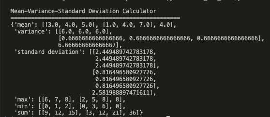
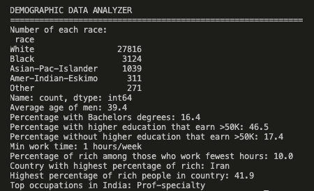
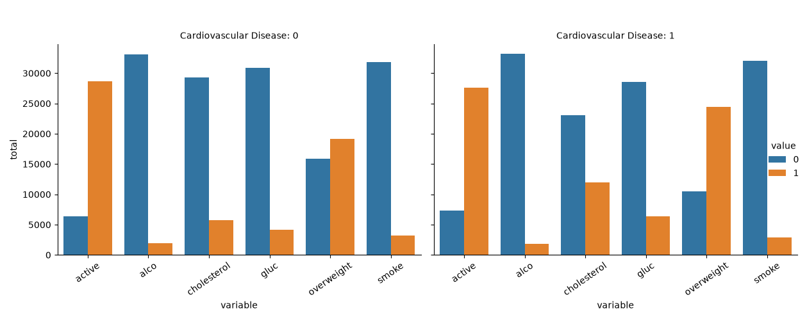
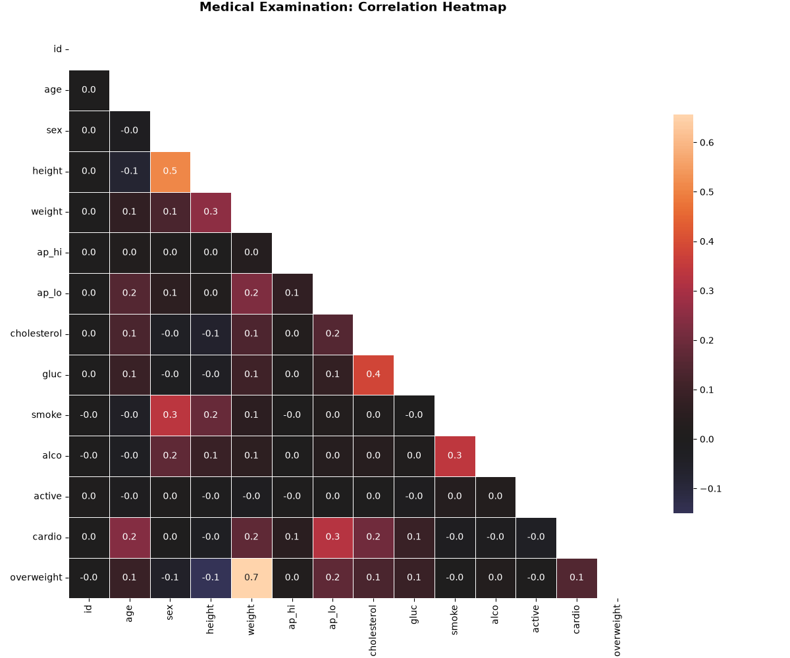
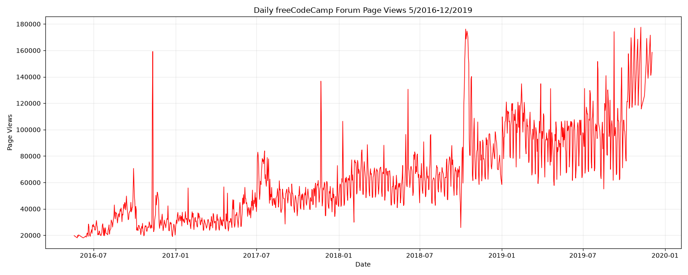
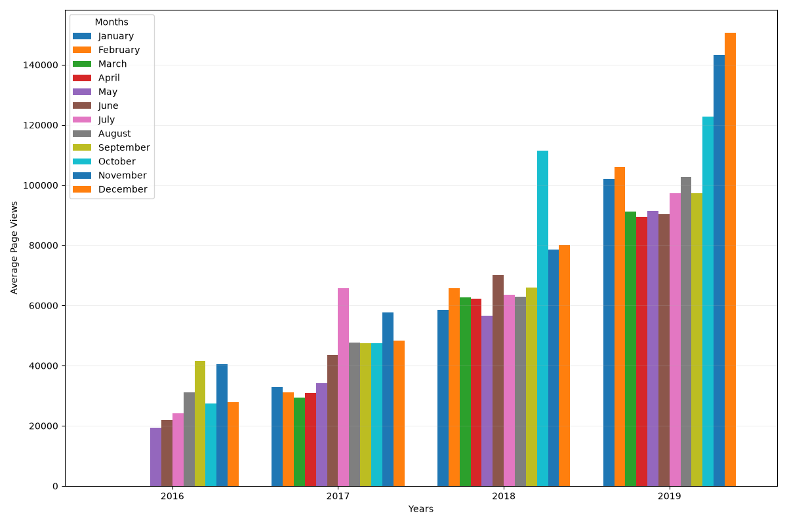
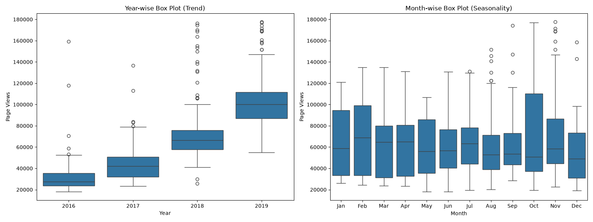
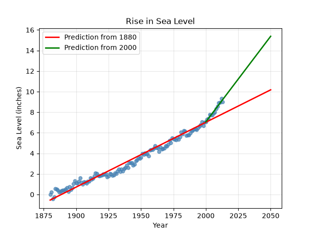

# Data Analysis with Python

### Professional Practice | Data Science | Teclab

This repository contains five practical data analysis projects developed as part of the **Professional Practice course of the Higher Technical Degree in Data Science at Teclab**.

The projects are based on the **Data Analysis with Python certification program by freeCodeCamp**, applying theoretical knowledge to practical problems involving statistical analysis, data manipulation, data cleaning, and visualization.

Each project focuses on different aspects of data analysis using Python and its main scientific computing libraries.

---

## Technologies & Tools

| Technology | Purpose |
|------------|---------|
| Python | Data processing and analysis |
| NumPy | Numerical and statistical calculations |
| Pandas | Data manipulation and transformation |
| Matplotlib | Data visualization |
| Seaborn | Statistical visualization |
| SciPy | Statistical modeling and linear regression |
| Git & GitHub | Version control |

---

## Projects

### 1. Mean-Variance-Standard Deviation Calculator

**Objective:** Apply fundamental statistical operations to numerical data using NumPy.

This project transforms a list of nine numbers into a 3×3 matrix and calculates descriptive statistics across rows, columns, and the entire matrix.

**Key concepts:**
- Multidimensional arrays and matrix operations
- Mean, variance, and standard deviation
- Minimum, maximum, and sum
- Data validation and numerical calculations

**Result:**



---

### 2. Demographic Data Analyzer

**Objective:** Explore demographic characteristics and identify patterns related to education, occupation, and income.

Using a dataset derived from the U.S. Census, this project applies Pandas to analyze demographic distributions and relationships between socioeconomic variables.

The analysis includes education levels, income distribution, working hours, occupations, and comparisons between population groups.

**Key concepts:**
- Exploratory Data Analysis (EDA)
- Data filtering and aggregation
- Demographic and income analysis
- Statistical comparisons between population groups

**Result:**



---

### 3. Medical Data Visualizer

**Objective:** Analyze medical examination records to identify relationships between cardiovascular conditions and health indicators.

The project includes data preprocessing, Body Mass Index (BMI) calculations, normalization of medical indicators, and correlation analysis.

Two visualizations are generated to explore categorical variables and relationships between medical measurements.

**Key concepts:**
- Data cleaning and preprocessing
- Body Mass Index (BMI)
- Categorical data visualization
- Correlation matrices and heatmaps

**Categorical Plot**



**Correlation Heatmap**



---

### 4. Page View Time Series Visualizer

**Objective:** Analyze website traffic trends and seasonal patterns using historical time series data.

This project examines daily page views from the freeCodeCamp forum between May 2016 and December 2019.

The analysis includes removing extreme values, calculating monthly averages, and comparing distributions across years and months.

**Key concepts:**
- Time series analysis
- Outlier detection using percentiles
- Monthly and yearly data aggregation
- Trend and seasonality analysis

**Daily Page Views — Line Plot**

Displays the evolution of daily forum visits over time.



**Monthly Average Page Views — Bar Plot**

Compares average daily page views for each month, grouped by year.



**Yearly and Monthly Distributions — Box Plot**

Analyzes variations and distributions in page views across years and months.



---

### 5. Sea Level Predictor

**Objective:** Analyze historical sea level measurements and estimate future changes using statistical modeling.

This project applies linear regression to historical sea level data, comparing long-term trends with more recent observations.

The resulting visualization projects sea level changes through 2050 based on historical measurements.

**Key concepts:**
- Linear regression
- Historical data analysis
- Trend estimation
- Predictive modeling and visualization

**Result:**



---

## Project Structure

```text
data-analysis-with-python/
│
├── demographic-data-analyzer/
│   ├── adult.data.csv
│   ├── demographic_data_analyzer.py
│   ├── demographic_data_analyzer.png
│   └── test_module.py
│
├── mean-variance-calculator/
│   ├── mean_var_std.py
│   ├── mean_var_std.png
│   └── test_mean_var_std.py
│
├── medical-data-visualizer/
│   ├── medical_examination.csv
│   ├── medical_data_visualizer.py
│   ├── catplot.png
│   ├── heatmap.png
│   └── test_module.py
│
├── page-view-time-series/
│   ├── fcc-forum-pageviews.csv
│   ├── time_series_visualizer.py
│   ├── line_plot.png
│   ├── bar_plot.png
│   ├── box_plot.png
│   └── test_module.py
│
├── sea-level-predictor/
│   ├── epa-sea-level.csv
│   ├── sea_level_predictor.py
│   ├── sea_level_plot.png
│   └── test_module.py
│
├── .gitignore
└── README.md
```

Each directory contains the corresponding Python implementation, datasets when required, unit tests, and generated results.

---

## Learning Outcomes

Through the development of these five projects, the following technical competencies were applied and reinforced:

- Data manipulation and transformation using Python.
- Exploratory and descriptive statistical analysis.
- Data cleaning and outlier detection.
- Numerical operations with multidimensional arrays.
- Data visualization and interpretation.
- Time series analysis and predictive modeling.
- Code validation through automated unit testing.

These skills provide a foundation for analyzing real-world datasets, identifying patterns, and developing data-driven solutions.

---

## Academic Context

| | |
|---|---|
| **Institution** | Teclab |
| **Degree** | Higher Technical Degree in Data Science |
| **Course** | Professional Practice |
| **Learning Platform** | freeCodeCamp |
| **Certification Program** | Data Analysis with Python |
| **Projects** | 5 |

These projects were developed for educational purposes, integrating the practical exercises provided by freeCodeCamp into the academic framework of Teclab's Professional Practice course.

---

## References

- [freeCodeCamp — Data Analysis with Python](https://www.freecodecamp.org/learn/data-analysis-with-python/)
- [Teclab — Official Website](https://www.teclab.edu.ar/)